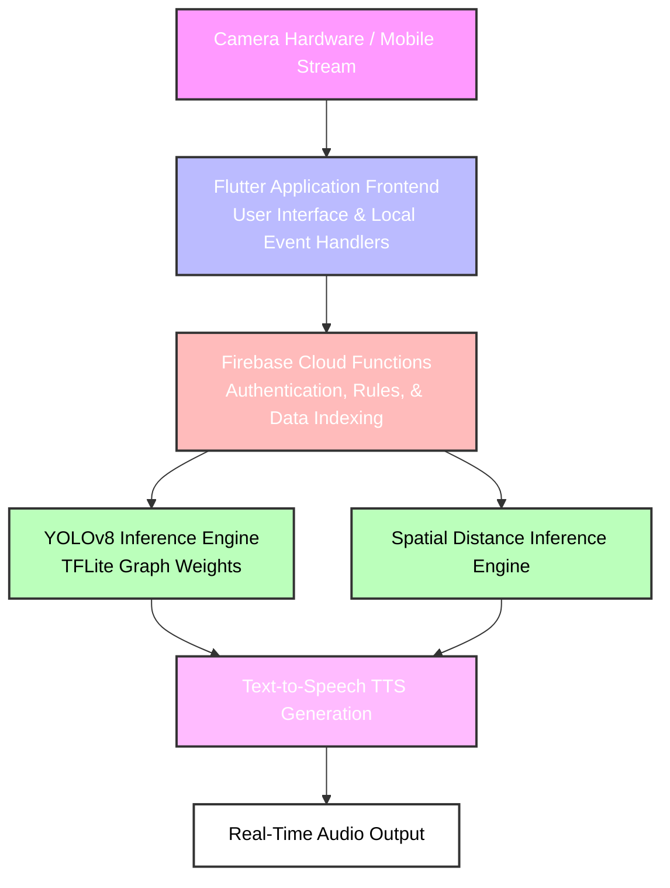

# Visio-Sense: Intelligent Assistive System for the Visually Impaired

This repository contains the official implementation of **Visio-Sense**, an advanced assistive technology solution developed as the **Final Group Project** for the **National Diploma in Technology (NDT)** program at the **Institute of Technology, University of Moratuwa (ITUM)**.

Visio-Sense bridges the accessibility gap for visually impaired individuals by combining cross-platform mobile application architecture, custom edge computer vision pipelines, serverless cloud systems, and real-time audio synthesis.

---

## Project Overview

Visio-Sense functions as an artificial pair of eyes, transforming dynamic visual environments into actionable auditory guidance. By combining an optimized cross-platform Flutter application with a custom-trained **YOLOv8 (You Only Look Once)** convolutional neural network, the system interprets the surrounding physical space, isolates critical obstacles, maps spatial proximity vectors, and processes real-time verbal warnings to ensure safer independent navigation.

### Key Objectives
* **Custom Object Detection:** Utilizing a custom-trained YOLOv8 architecture optimized to detect common indoor and outdoor obstacles, including cars, chairs, and tables.
* **Spatial Proximity Inference:** Computing dynamic bounding box geometry transformations and Intersection over Union (IoU) spatial matrices to estimate target proximity.
* **Cross-Platform System Integration:** Linking a high-performance Flutter mobile frontend with serverless backend controls and real-time data streaming architectures.

---

## Deep Learning Pipeline & Model Training

The core intelligence of Visio-Sense relies on an optimized object detection model trained on custom-curated datasets following standard industry MLOps workflows.

The complete engineering pipeline consists of data engineering, cloud-accelerated model training, and edge runtime compilation:

1. **Data Curation & Annotation:** Custom scene images containing structural navigation hazards were collected, managed, and structurally annotated using the **Roboflow Ecosystem** to construct targeted bounding box labels.
2. **Cloud-Accelerated Training:** The annotated image corpus was exported into an external **Jupyter Notebook environment (Google Colab)** via the Roboflow API. The network was trained using an **NVIDIA Tesla T4 GPU (15GB VRAM)** for **100 epochs** with an automated mixed precision (AMP) framework.
3. **Edge Graph Compilation:** The final high-performing PyTorch graph weights were compiled, optimized, and serialized into a lightweight TensorFlow Lite (`.tflite`) binary format with a forced resolution of 300x300 pixels, enabling low-latency, on-device mobile inference within the mobile container.

### Model Specifications & Performance Benchmarks
* **Core Architecture:** Ultralytics YOLOv8s (Small Variant)
* **Target Classes (nc=3):** `car`, `chair`, `table`
* **Box Precision (P):** 0.971 (97.1%)
* **Recall (R):** 0.940 (94.0%)
* **mAP@50:** 0.965 (96.5%)
* **Inference Speed:** 3.5ms per image (Fused Model Summary: 168 layers, 11,126,745 parameters)

---

## System Architecture & Technical Pipeline

The system is structured as an end-to-end processing pipeline, optimizing cross-platform mobile environments without sacrificing runtime latency.

1. **Visual Capture:** Real-time environmental inputs are initialized via the device camera or local mobile video stream.
2. **Cross-Platform Mobile Frontend:** The Flutter application framework acts as the central client-side orchestration hub, managing state logic, capturing peripheral video frames, and handling native event triggers.
3. **Cloud Infrastructure Backend:** The serverless Firebase Cloud Functions environment securely manages authentication protocols, handles database indexing logic, and dynamically updates real-time operations.
4. **Edge Machine Learning Inference:** The incoming camera buffers are passed through an optimized on-device YOLOv8 TFLite graph model alongside a dynamic spatial distance inference engine to compute geometric threat matrices.
5. **Speech Synthesis Engine:** Evaluated obstacle classifications and proximity vectors are converted into context-aware natural language speech payloads delivered instantaneously to the user.

---

### Key Custom Computations Implemented:
1. **Class Remapping Matrix:** Constraints the pre-trained neural network boundaries natively using an array filter and maps the classes into a localized configuration `{2: 0, 56: 1, 60: 2}` to track only `car`, `chair`, and `table` classes.
2. **IoU-Based Duplicate Suppression:** Implements a structural geometric Intersection over Union (IoU) calculation layer with a threshold limit of `>0.5` to prevent close-proximity duplicative bounding box generations specifically for overlapping `chair` detections. This minimizes notification duplication for clustered objects.
3. **Edge Quantization Export:** Embedded an automated deployment compilation layer utilizing Ultralytics and TensorFlow Lite serialization libraries to compile, optimize, and export the trained computational graphs into optimized `.tflite` format.

---
